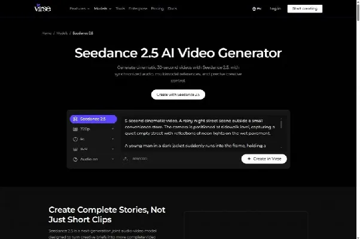
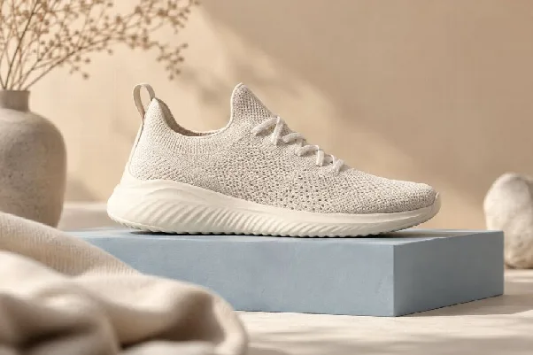
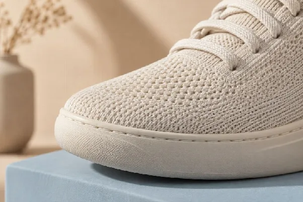

# Image-to-Video Camera Movement for Product Ads

_Cover image by Voyage Pro via [Unsplash](https://unsplash.com/photos/a-white-tent-with-a-camera-on-it-ZEhkny-7w1c)_

Image-to-video camera movement works best when the planned motion respects the source image's composition, depth, and visible subject detail. Choose a move that serves the message, describe it separately from the subject's action, and review the result in its intended crop.

If your campaign stills and motion references live in different places, it is easy to lose the approved visual direction. [Seedance 2.5](https://www.virse.ai/models/seedance-2-5) on Virse can be used within a visual workspace that brings image concepts and video references into the same creative process.

_Virse's public Seedance 2.5 page, captured October 8, 2026. Public-page screenshot; no account generation was run._

This guide is for marketing teams and designers turning approved product stills into ad creatives. The sample briefs are illustrative starting points, not tested prompts or promises of identical behavior across video models.

For a marketing training exercise, keep the product reference fixed and compare a restrained move with a static framing. Ask learners to identify any changes in product detail before judging which version would suit the campaign. This is a proposed exercise, not a report of measured generation performance.

## How Do You Plan Image-to-Video Camera Movement?

Plan image-to-video camera movement by deciding what the viewer should notice as the shot develops. Then choose the least complicated motion that reveals or emphasizes that information.

A slow move toward a shoe might draw attention to its material. A lateral move could reveal the relationship between foreground and background. A locked camera with a small movement in the scene may be enough for an asset that needs a calm visual treatment.

Inspect the source image before writing a prompt. Identify the focal point, the foreground and background, and the area available around the subject. Look for details that must remain accurate, such as a logo, a label, or a recognizable contour.

Write a short purpose statement. For example: "Move attention from the complete shoe to the upper material while preserving the product's proportions." That statement helps you judge the result without being distracted by an attractive but irrelevant camera move.

## Which Camera Move Fits the Source Image?

Choose a move whose changing viewpoint can be supported by the image and available references. The more unseen surface or space the movement reveals, the more carefully the result needs to be checked.

A pan rotates the camera horizontally from a fixed position. A dolly move changes the camera's position through the scene. Adobe's explanation of the pan shot distinguishes those movements. In an AI brief, the distinction helps describe the intended viewpoint change; it does not guarantee a physically exact camera simulation.

| Source-image condition | Move to consider | What needs inspection |
| --- | --- | --- |
| Clear subject with space around it | Restrained push-in | Subject size and the remaining crop |
| Distinct foreground and background | Small lateral move | Relative movement and spatial relationships |
| Product with accurate views from several angles | Limited orbit | Shape, label, and newly visible surfaces |
| Flat graphic or shallow composition | Locked camera with subtle scene motion | Graphic integrity and unintended deformation |
| Tight portrait or close product crop | Minimal movement | Edges, expression, and lost detail |

Parallax is the difference in apparent movement between elements at different depths. It can make a camera move feel spatially convincing. When the source provides little depth information, a large viewpoint change gives the generator more of the scene to invent.

For a product asset, treat hidden geometry as unverified. If a proposed orbit reveals the underside of a shoe, obtain a suitable reference or choose a move that keeps the approved view. A plausible-looking surface is not evidence that the product actually has that construction.

## How Do You Write a Motion Brief?

Write a motion brief that separates camera behavior, subject action, and environmental movement. State the intended ending so the clip has a usable destination.

Runway's photo-to-video guide organizes prompting around camera movement, scene action, and atmospheric details. Use that distinction to keep your request readable, while adapting the wording to the model and controls you actually use.

For an illustrative shoe campaign, the brief could be:

> Use the supplied shoe image as the visual reference. The camera moves slowly closer while the shoe remains stationary on the plinth. Preserve the visible product shape and material appearance. Keep the lighting direction stable. End with the upper material clearly visible and enough space around the shoe for the planned crop.

The brief assigns movement to the camera and stability to the product. It also defines the endpoint in terms the designer can inspect. If the result rotates the shoe or changes the sole, the failure is specific enough to address in the next revision.

Begin with one principal camera move. Combining an orbit, a rapid push-in, and a change of angle gives a short clip several competing instructions. Add complexity only when the simpler version communicates the idea and the additional movement has a clear purpose.

Keep adjectives subordinate to observable directions. "Elegant" can describe the desired tone, but "slow lateral movement with the product held at a consistent size" tells the model what should happen in the frame.

_Distinct foreground and background layers provide visible depth to consider when planning a restrained camera move. AI-generated editorial illustration; not a measured tool result._

## What Changes When You Use Seedance 2.5?

When using Seedance 2.5 through Virse, organize the approved stills and any motion references around their intended roles. The public product page describes image, video, and audio references, along with camera and timeline direction; inspect the controls available in the selected workflow before generating.

Use an image to establish the subject or composition, and a motion reference only when it adds a useful movement pattern. State what should transfer from the reference. A clip chosen for its camera path should not quietly become a request to copy its setting, clothing, or lighting.

Keep the first attempt easy to evaluate. If the campaign needs a restrained product move, establish that shot before adding a new environment or a more elaborate sequence. Compare outputs against the same still so changes in the product's appearance remain visible.

The workflow should keep a clear distinction between the approved asset and generated alternatives. Keep the original still available throughout review. A newer output can look more dramatic while moving away from the design the team approved.

## How Do You Protect the Crop and Visual Hierarchy?

Protect the crop by reviewing the entire movement inside the intended placement, including the subject's largest apparent size and final position. Protect visual hierarchy by keeping the main subject more legible than the movement around it.

An image that starts with generous space can become crowded during a push-in. A pan may move the subject into an area intended for copy. Check the start, the most constrained moment, and the ending rather than judging only the opening frame.

| Review point | Question |
| --- | --- |
| Opening | Is the approved composition recognizable? |
| During movement | Does the subject remain readable inside the intended crop? |
| Background | Does motion draw attention away from the product? |
| Text area | Is the planned copy space usable throughout the relevant moment? |
| Ending | Can the shot hold or cut where the edit requires it? |

Treat each placement as a composition problem. A wide asset and a vertical asset may need different framing or separate generations. Do not rely on a late center crop if the move carries important detail toward an edge.

Keep required typography in an appropriate editing or layout workflow. The motion background should support the message; it should not force the designer to shrink the headline or cover the product simply to make the existing clip fit.

## Which Failures Call for a Simpler Move?

Simplify the move when the source cannot support the requested viewpoint change or when the movement overwhelms the visual purpose. Reduce the demand before repeatedly regenerating the same brief.

If the product deforms during an orbit, try a smaller viewpoint change or a move toward the established view. If the background stretches during a lateral move, review whether its spatial structure is clear enough. A locked camera with subtle light or environmental movement may be more suitable.

MotionLab's camera-motion guide discusses choosing frames that can support motion and using atmosphere when a large camera move is unsuitable. Apply those ideas as planning options, then evaluate the actual output in your chosen model.

Change one meaningful variable between attempts where possible. Keep the source image, subject instruction, and lighting description stable while simplifying the camera move. Record the reason for the revision so the next comparison answers a useful question.

_A closer composition can emphasize material detail without inventing an unseen side of the product. AI-generated editorial illustration; not a measured tool result._

## Questions About Camera Movement

### Is a Zoom the Same as a Dolly Move?

They describe different visual behavior. A dolly changes the camera's position, while a zoom changes the framing through the lens. For an AI brief, state the effect you need and inspect the resulting perspective rather than assuming a movement label will produce an exact physical simulation.

### Can a Flat Design Become a Moving Asset?

Yes, but the motion should suit the source. A subtle change in light, a controlled movement of an element, or a mostly static hold may preserve the graphic more effectively than a large change of viewpoint. Check edges and typography whenever the source contains graphic detail.

### What Should You Save With the Approved Clip?

Save the source image, motion brief, references, and intended crop with the selected output. That package makes image-to-video camera movement easier to reproduce or revise when the campaign needs another placement. Approve the movement only after seeing it in the layout where it will run.
