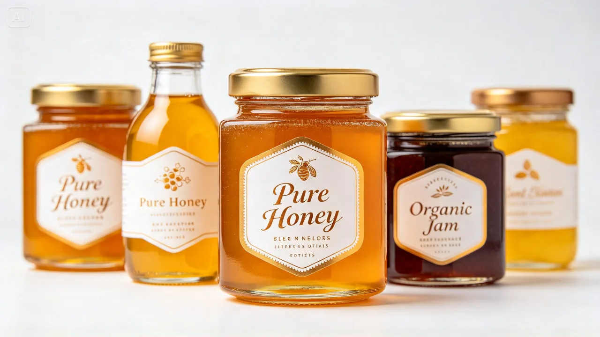
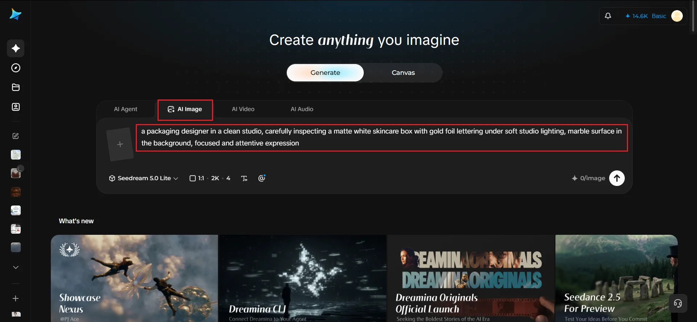
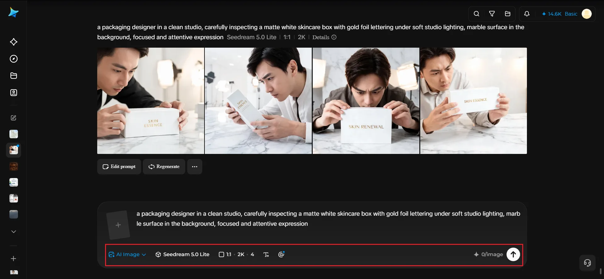
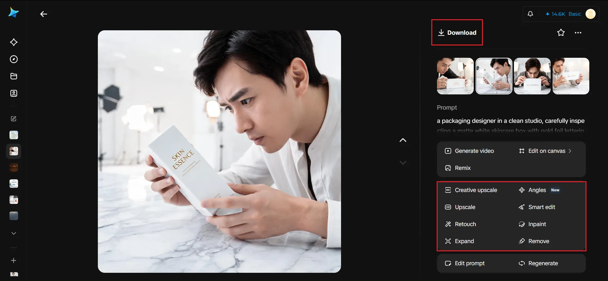

# How to Create Creative Packaging Mockups for New Product Launches

_Cover image created with [Dreamina](https://dreamina.capcut.com/tools/ai-image-generator)_

Before a product ever reaches a manufacturer, most teams need a way to see what the packaging might look like: not a flat design file, but something that reads like a real object sitting on a shelf. That has traditionally meant hiring a mockup specialist or buying expensive template packs that never quite match the exact product shape needed.

An [online AI image generator](https://dreamina.capcut.com/tools/ai-image-generator) removes that dependency, letting a team generate realistic, custom packaging mockups directly from a design concept, without searching for the one template that happens to fit. Dreamina, powered by the Seedream 5.0 Pro model, is well equipped for this kind of product-realistic rendering.

## Realistic mockups before manufacturing

A packaging design that looks great as a flat file can behave very differently once it is wrapped around an actual three-dimensional object. Proportions shift, text can wrap awkwardly, and materials catch light in ways a flat render never shows. A realistic mockup catches these issues early, before they turn into an expensive manufacturing mistake.

## Key details that make a mockup feel believable

A handful of specific details separate a convincing mockup from an obviously artificial one:

- Accurate material rendering: matte, glossy, textured, or metallic
- Realistic shadow and reflection grounding the object in its setting
- A background simple enough not to distract from the packaging itself
- Correct proportion and scale for the actual product inside

## Generating mockups for different packaging formats

Different product categories call for very different mockup styles:

- **Boxes and cartons:** standing upright with a visible front panel
- **Bottles and jars:** centered with label detail clearly legible
- **Pouches or flexible packaging:** shown with natural folds and slight creasing
- **Multi-piece sets:** arranged together to show how the full line looks as a collection

## Testing packaging across multiple contexts

A single mockup angle rarely tells the whole story. Generating a few variations, such as a straight-on shot, an angled view, and a styled lifestyle shot with the product in a real-feeling setting, gives a much fuller sense of how the packaging will perform once it is out in the world.

## Using mockups to support early stakeholder decisions

Realistic mockups are not just useful internally. A convincing render can carry real weight in conversations with investors, retail partners, or early customers who are trying to picture the finished product before it physically exists.

## Generating the mockup with Dreamina

### Step 1: Enter a text prompt

Open Dreamina and write a detailed text prompt describing your packaging concept, including material, color, and setting.

For a version featuring a person in the relevant field, try: *a packaging designer in a clean studio, carefully inspecting a matte white skincare box with gold foil lettering under soft studio lighting, marble surface in the background, focused and attentive expression*

You can also upload your flat design file as a reference image so Dreamina wraps it realistically onto a three-dimensional mockup.

### Step 2: Adjust parameters and generate

Set the model to Image 5.0 Pro by Seedream 5.0 Pro for accurate material rendering and realistic lighting. Choose the aspect ratio suited to the mockup's purpose, square for a product listing or landscape for a presentation slide, and select 1K for a quick internal review or 2K for a mockup you will share externally. Click the generate button to create the images.

### Step 3: Customize and download

Use Dreamina's AI editing options to refine the mockup: inpaint to adjust a label detail or lighting highlight, expand the canvas if you need more surrounding context, remove any distracting background element, and retouch for a polished, shelf-ready finish. Once it looks right, click the download icon to save it.

## Why Seedream 5.0 Pro handles packaging realism well

Convincing mockups depend heavily on how believably a model renders material properties: the soft sheen of matte cardstock, the reflective curve of a glass bottle, the subtle texture of embossed lettering.

Seedream 5.0 Pro, Dreamina's newest model, handles this kind of material and lighting detail with strong consistency, which gives its mockups a product-realistic feel rather than an obviously synthetic one. That realism is especially valuable at the pre-manufacturing stage, when a mockup often needs to stand in for a product that does not physically exist yet.

## Catching design issues before they reach production

A realistic mockup is also a practical review tool. Viewing a label at actual proportion, rather than as a flat file, often reveals text sized too small to read, a logo placement that looks off-center once wrapped around a curved surface, or color that reads differently under simulated lighting than it did on a screen.

## Building a mockup library across the whole product line

As a brand launches multiple products, keeping a consistent mockup style across the whole catalog (same lighting setup, same background treatment, same camera angle) gives the product line a unified, professional presentation even before any of it reaches a retail shelf.

## Common mockup mistakes worth avoiding

- Backgrounds too busy, which distract from the actual packaging
- Lighting that does not match across different mockups in the same line
- Skipping an angled or lifestyle shot in favor of only a flat front view
- Using a mockup that does not reflect the actual final material choice

## Conclusion

Seeing a product's packaging rendered realistically before it is ever manufactured gives a team real confidence heading into production, and catches costly mistakes while they are still easy to fix.

With attention to material and lighting detail, and Dreamina's Seedream 5.0 Pro model generating shelf-ready mockups directly from a design concept, a new product launch can look fully realized long before the first physical unit is printed.
